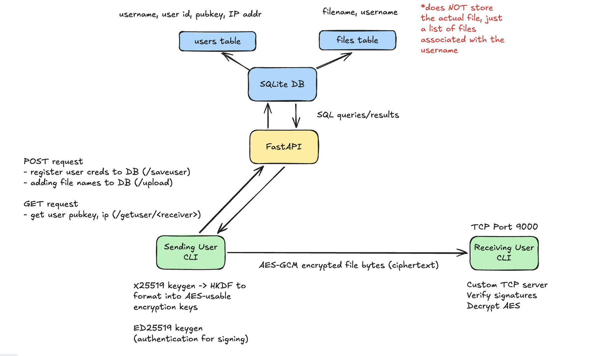

# Conduit

A file-transfer CLI tool that lets users upload and download files with E2E encryption

### Usage

`./conduit <command>`

commands:

- `setup <username>` = makes keys, registers user to the server
- `library` = displays profile and files
- `upload <filename>` = copies a local file into the library, records it onto the server
- `listen` = waits for incoming files. reminder to run `Ctrl-C` to end the session too
- `transfer <filename> <username>` = sends a file from your library to the other user
- `help` = lists out the commands (a built-in `urfav/cli` command, pretty nice)

### Running the project

Requires Go and Python 3.

1. **Start the server** (first time only: `python3 -m venv .venv && source .venv/bin/activate && pip install -r requirements.txt`)
    ```zsh
    cd backend
    source .venv/bin/activate
    fastapi dev main.py
    ```
2. **Build the CLI** (in a new terminal, from the project root)
    ```zsh
    go build -o conduit .
    ```
3. **Register yourself**
    ```zsh
    ./conduit setup <username>
    ```
4. **Use it**: `./conduit listen` to receive, or `./conduit upload <file>` then `./conduit transfer <filename> <username>` to send. Keys and files are stored in `~/.conduit`.

### Testing

**Unit tests** (run from the project root)
```zsh
go test ./tests/ -v      # just the tests folder, with each test's name + result
go test ./...            # everything in the project
```
`tests/encryption_test.go` checks that:
- both users derive the same 32-byte AES key (X25519 + HKDF)
- encrypt → decrypt gives back the original message (AES-GCM)
- a tampered ciphertext fails to decrypt (GCM tag)
- input shorter than the nonce returns an error instead of crashing

**End-to-end transfer:** two fake users (Alice and Bob) on one machine, kept apart with `CONDUIT_DIR`. Use 3 terminals.

1. **Terminal 1: server**
    ```zsh
    cd backend && source .venv/bin/activate && fastapi dev main.py
    ```
2. **Terminal 2: Bob (receiver)**
    ```zsh
    export CONDUIT_DIR=/tmp/conduit-test/bob
    go build -o conduit .
    ./conduit setup bob
    ./conduit listen
    ```
3. **Terminal 3: Alice (sender)**
    ```zsh
    export CONDUIT_DIR=/tmp/conduit-test/alice
    echo "hello from alice" > /tmp/conduit-test/test.txt
    ./conduit setup alice
    ./conduit upload /tmp/conduit-test/test.txt
    ./conduit transfer test.txt bob
    ```
4. **Check it arrived**
    ```zsh
    cat /tmp/conduit-test/bob/library/test.txt    # "hello from alice"
    ```
5. **Check it's encrypted** (4th terminal, start before step 3): if you can read `hello from alice` in the output, it isn't encrypted.
    ```zsh
    sudo tcpdump -i lo0 -A port 9000
    ```
6. **Start fresh**
    ```zsh
    rm -rf /tmp/conduit-test backend/conduit.db
    ```

Notes:
- Bob must be listening before Alice sends.
- Use absolute paths for `CONDUIT_DIR`.
- Delete `backend/conduit.db` after changing the database tables.
- Check what the server stores at `http://127.0.0.1:8000/getuser/<username>`.

### Architecture



### Tech Stack

- Golang (urfave/cli, cryptography)
    - CLI commands
    - Cryptography package
- Python/FastAPI
    - Mostly to learn how to use FastAPI, otherwise Go's https package has the same
- SQL
    - Source of truth database for users (usernames, userid, pubkey, ip addr) and files (filename, username)

### Cryptography

- Typically the CIA Triad is a common model that gets brought up in classes, aka the Confidentiality, Integrity, Availability Triad
- For crypto, specifically this project, I'm using that to focus on two main goals:
    - Make sure data in transit is encrypted (confidentiality, integrity)
    - Make sure the data is sent by trusted individuals (authentication - not the A in the CIA triad)

- Essentially, the crypto for conduit is as follows:
    1. Key and identity
        - Generate a public/private key pair per user - using X25519
            - Your private key/their public key == their private key/your public key
        - Generate a public/private key pair per user to identify the individual (create authentication) - using ED25519
            - Prevents MITM attacks b/c signing can help detect tampering

    2. Convert the X25519 shared secret into usable AES keys using HKDF
        - Because X25519 shared secrets aren't usable in their outputted format

    3. AES-GCM symmetrically encrypts the file
        - This also technically has integrity b/c of the GCM part - GCM generates a tag that gets checked during decryption to determine if tampering occured, which proves that someone with the key sent the msg
        - Note that this is different from the ECB (leaks patterns bc the same pt gives the same ct) and CBC (chaining) modes of AES

    4. File gets passed through using net.Conn
        - Note that this is NOT encrypted TCP, hence the need for AES/X25519/etc encryption

### Pivots

- Started with Claude/ChatGPT-ing an architecture - my only constraints were that I knew I wanted AES and ed25519 encryption (googled the best digital signature algorithms -> ECDSA -> ed25519)
    - Realized that I didn't actually understand what was happening, so instead, started with user stories: what commands would a user input?
        - Worked out better :")

- Started with the Bubble Tea TUI package => realized that I was spending more time customizing the user-interface rather than building in the command functionality, and that I'd eventually need a way for the user to get commands - `if user_input == "conduit xyz"` didn't seem like a structurally best practice for code (very repetitive and fragile)
    - Searched for packages designed for building CLI commands, specifically noted `Cobra` and `urfav/cli`, and how they're built for standard CLI commands rather than my original idea of an "interactive shell"
        - Thought this was a better idea instead of an "interactive shell" b/c I only really wanted a welcome message, and the CLI packages are already fairly popular with a similar use-case
            - Chose urfav/cli b/c of its simpler usage (not building anything super complex so don't need Cobra) and can always pivot to Cobra if this grows (but don't anticipate it)
